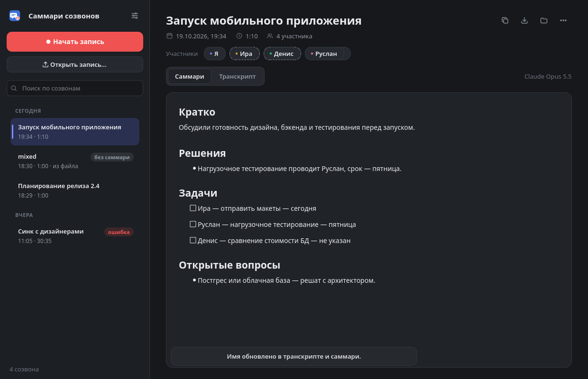
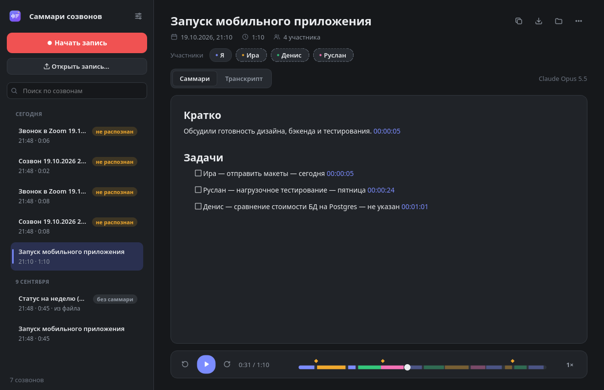
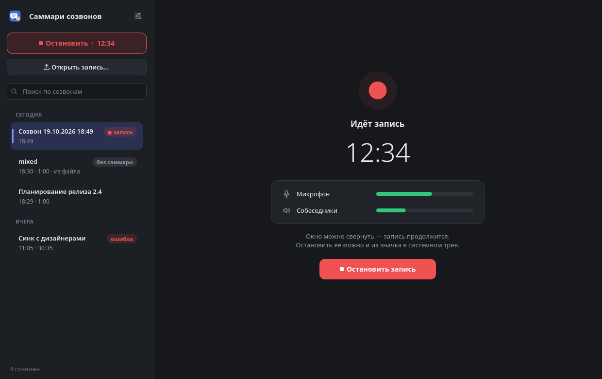
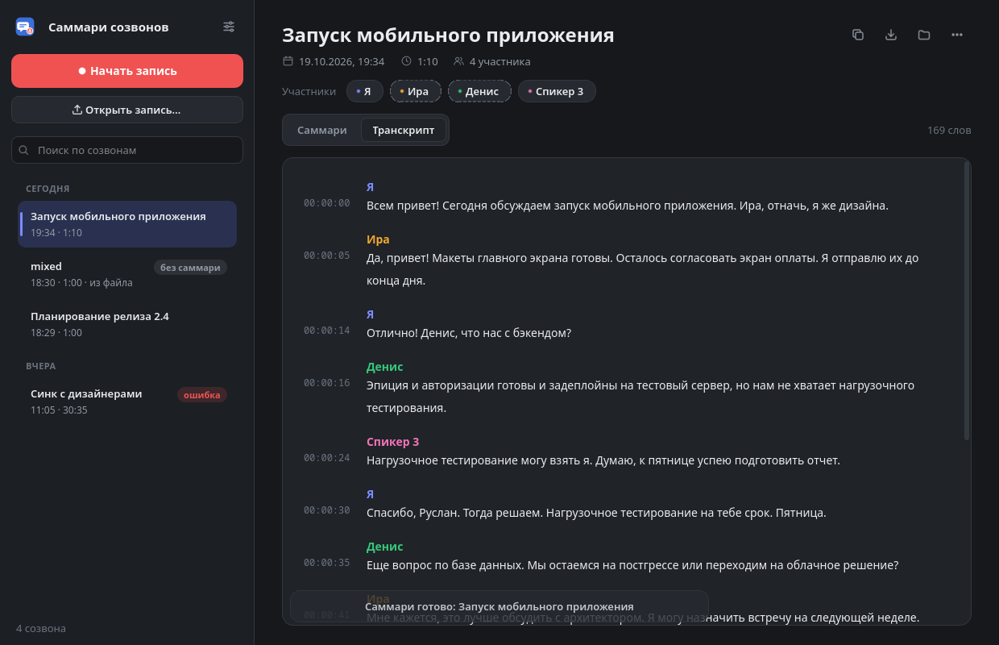

# Саммари созвонов

[](CHANGELOG.md)
[](https://github.com/Dartanyun/call-summarizer/actions/workflows/ci.yml)
[](https://github.com/Dartanyun/call-summarizer/actions/workflows/windows.yml)
[](#установка)
[](pyproject.toml)
[](https://doc.qt.io/qtforpython-6/)
[](https://docs.claude.com/)
[](LICENSE)

Приложение для Linux (Debian, KDE, GNOME и др.) и Windows 10/11: записывает созвон, локально распознаёт
речь и делает структурированное саммари через Claude — или локальную модель, тогда текст не покидает
компьютер. Подробная справка встроена в программу: **F1** или кнопка «?».

- **Запись**: микрофон и звук собеседников (всё, что звучит в колонках/наушниках) пишутся на две
  отдельные дорожки. Работает с любым приложением для звонков: Zoom, Telegram, Google Meet в браузере,
  Discord, Slack и т. д.
- **Импорт**: можно открыть готовую запись — mp3, m4a, ogg, wav, mp4, mkv, webm…
- **Распознавание**: локально, через [faster-whisper](https://github.com/SYSTRAN/faster-whisper).
  Звук никуда не отправляется.
- **Кто говорит**: реплики подписаны — «Я», «Ира», «Денис»… Ваши реплики определяются по дорожке
  микрофона, собеседники различаются по голосу (локально, через
  [sherpa-onnx](https://github.com/k2-fsa/sherpa-onnx)). Claude по разговору подставляет имена
  («Ира, начнёшь?» — «Да…»), а любого участника можно переименовать одним кликом: имя обновится
  в транскрипте и в саммари.
- **Запоминание голосов**: назвали участника один раз — в следующих созвонах он подпишется сам,
  по голосу. Ваш собственный голос запоминается автоматически, так что вы узнаётесь и в
  импортированных записях. «Отпечатки» голосов хранятся только на этом компьютере.
- **Плеер**: запись можно слушать прямо в окне — с перемоткой и скоростью до 2×. Клик по таймкоду
  в транскрипте или по таймкоду в пункте саммари включает запись с этого места, а звучащая
  реплика подсвечивается.
- **Словарь**: названия проектов, термины, имена коллег подсказываются и Whisper, и Claude — меньше
  ошибок вроде «Эпиция» вместо «API». Ошибку можно исправить прямо в транскрипте: выделите слово →
  правая кнопка → «Исправить…». Исправление применится ко всему созвону и попадёт в словарь.
- **Саммари**: в Claude уходит только текст транскрипта. Получаются разделы «Кратко», «Ключевые темы»,
  «Решения», «Задачи» (чек-лист «кто — что — срок», сроки вроде «к пятнице» переводятся в даты),
  «Открытые вопросы» и «Хронология» — главы созвона с таймкодами.
- **Шаблоны под тип встречи**: планёрка, 1:1, собеседование, звонок с клиентом, лекция или свой
  шаблон. По умолчанию модель сама понимает, что это за встреча.
- **Локальная модель (Ollama)**: саммари, вопросы и итоги недели без интернета — текст созвонов
  не покидает компьютер.
- **Отметки «важный момент»**: Ctrl+B или Meta+Shift+B из любого окна прямо во время звонка. Отметки
  видны флажками на шкале плеера, а в саммари появляется раздел «Отмеченные моменты».
- **Статистика разговора**: кто сколько говорил (диаграмма), темп речи, перебивания, самый длинный
  монолог, слова-паразиты, самые частые слова.
- **Спросить у созвонов**: «что мы решили про бюджет?», «что обещал Денис?» — ответ со ссылками
  на моменты записей. Поиск по транскриптам идёт на компьютере, модели уходят только подходящие куски.
- **Итоги недели**: главное, решения, задачи по людям и что зависло — по всем созвонам недели,
  по кнопке или по расписанию (по умолчанию в пятницу в 17:00).
- **Календарь**: по ссылке iCal (Google, Outlook, Яндекс, iCloud) созвон получает название встречи,
  а участники из приглашения помогают подписать говорящих.
- **Задачи в трекер**: YouTrack, Todoist или напоминания в календарь (.ics) одной кнопкой.
- **Экспорт**: PDF, Word, Markdown, сообщение для Telegram, заметка в Obsidian со ссылками на участников.
- **Шумоподавление и видеокарта**: фильтр шума перед распознаванием, распознавание на NVIDIA (CUDA)
  в разы быстрее; без видеокарты всё работает на процессоре.
- **Обновления**: программа раз в день проверяет новую версию на GitHub и ставит её одной кнопкой —
  установщик Windows и архив .tar.gz без пароля, пакет .deb через системный запрос пароля.
- **История**: все созвоны сохраняются, их можно переименовать, скопировать саммари или экспортировать.
- **Тихий режим**: приложение живёт в трее и может запускаться вместе с системой. Оно само замечает
  звонок и записывает его — сразу или по клику на уведомление. Звонок замечается, когда Zoom,
  Telegram, Meet в браузере и т. д. начинают брать микрофон, а голосовой канал Discord — даже
  с выключенным микрофоном. Когда звонок заканчивается, запись останавливается сама.
- **Звук собеседников пишется оттуда, где звучит звонок**: если Discord или Telegram играют в
  наушники, а не в динамики, запись идёт с наушников. Подключили гарнитуру посреди разговора —
  запись переключится сама (если в настройках выбраны устройства «по умолчанию»).
  Уведомления можно сократить до «саммари готово» или выключить совсем.
- **Значок в трее показывает состояние**: ожидание, запись (красная метка), пауза (жёлтая),
  расшифровка и саммари (синяя). Подробности — во всплывающей подсказке.
- **Пауза записи** — для перерывов в длинной встрече (Ctrl+P или из меню значка).
- **Горячие клавиши Meta+Shift+Z и Meta+Shift+B** — начать или остановить запись и отметить
  важный момент из любого окна (в Windows — Win+Shift+Z и Win+Shift+B). Сменить: Параметры
  системы → Комбинации клавиш → «Саммари созвонов».
- **Таймлайн**: полоса над плеером показывает цветом, кто когда говорил, ромбиками — пункты
  саммари, чёрточками — главы, флажками — отметки. Клик или перетаскивание — переход к этому месту.
- **Поиск по всем транскриптам**: в списке виден фрагмент с найденным словом, а в транскрипте
  все совпадения подсвечены.
- **Автоочистка** (по желанию): аудио старше 7–180 дней удаляется, транскрипты и саммари остаются.
  Отдельный созвон можно защитить: «⋯» → «Не удалять аудио при автоочистке».

<p align="center">
  
  
</p>
<p align="center">
  
  
</p>

## Установка

### Готовые сборки

Проще всего — скачать файл для своей системы со страницы [Releases](https://github.com/Dartanyun/call-summarizer/releases):
Python и все библиотеки уже внутри, ничего докачивать не нужно.

| Система | Файл | Как поставить |
|---|---|---|
| Windows 10/11 | `CallSummarizer-X.Y.Z-windows-x64-setup.exe` | запустить; права администратора не нужны |
| Windows без установки | `CallSummarizer-X.Y.Z-windows-x64-portable.zip` | распаковать и запустить `CallSummarizer.exe` |
| Debian 12+, Ubuntu 22.04+ | `call-summarizer_X.Y.Z_amd64.deb` | `sudo apt install ./call-summarizer_X.Y.Z_amd64.deb` |
| Другие Linux | `call-summarizer-X.Y.Z-linux-x86_64.tar.gz` | распаковать и запустить `./install.sh` (без sudo) |

Установщик для Windows ставит программу в `%LOCALAPPDATA%\Programs\CallSummarizer` и ярлык — в ваше
меню «Пуск»; удаляется она через «Параметры → Приложения». Сборки не подписаны сертификатом, поэтому
Windows может показать «Система Windows защитила ваш компьютер» — «Подробнее» → «Выполнить в любом случае».
В Linux нужны пакеты `ffmpeg` и `pulseaudio-utils` (пакет `.deb` поставит их сам).

Модели для распознавания скачиваются при первом использовании — см. ниже.

### Из исходников: Linux

```bash
./install.sh
```

Скрипт ставит всё в домашнюю папку, без sudo. Код и зависимости кладутся в `~/.local/share/call-summarizer`,
команда — в `~/.local/bin/call-summarizer`, ярлык — в меню приложений. Нужны пакеты `ffmpeg`
и `pulseaudio-utils`; если их нет, скрипт подскажет команду `apt`.

При первом распознавании скачается модель Whisper (~1.6 ГБ для `large-v3-turbo`) в `~/.cache/huggingface`
и модели определения говорящих (~47 МБ, проверяются по SHA-256) в `~/.local/share/call-summarizer/models`.

### Из исходников: Windows 10/11

Права администратора не нужны: всё ставится в профиль текущего пользователя.

1. Скачайте репозиторий (зелёная кнопка **Code → Download ZIP**) и распакуйте его.
2. Дважды щёлкните **`install.cmd`**. Если Windows покажет «Система Windows защитила ваш компьютер» — это
   из-за того, что файл скачан из интернета: «Подробнее» → «Выполнить в любом случае».
3. Запуск — меню «Пуск» → **«Саммари созвонов»**.

Установщик сам скачает менеджер Python [uv](https://github.com/astral-sh/uv), Python 3.12 и библиотеки
(~1,3 ГБ) в `%LOCALAPPDATA%\CallSummarizer` — системный Python не нужен и не затрагивается. ffmpeg
входит в пакет `imageio-ffmpeg`. Ярлык создаётся в вашем меню «Пуск», автозапуск — в разделе реестра
текущего пользователя (`HKCU\…\Run`). Удаление — `uninstall.cmd` (записи остаются;
`uninstall.cmd -Purge` удалит и их).

Чем версия для Windows отличается:

| | Linux | Windows |
|---|---|---|
| Звук собеседников | монитор устройства вывода PipeWire | «петля» WASAPI с устройства вывода (как запись экрана в играх) — «Стерео микшер» не нужен |
| Как замечается звонок | потоки PipeWire: микрофон или голосовой поток Discord | отметка Windows «микрофон используется» (та же, что значок микрофона в трее) |
| Горячая клавиша | Meta+Shift+Z (через KDE) | Win+Shift+Z, если занята — Ctrl+Alt+Z |
| Уведомление «Начался звонок?» | с кнопками «Записать» / «Не записывать» | нажатие на уведомление начинает запись |
| Данные | `~/.local/share/call-summarizer` | `%LOCALAPPDATA%\CallSummarizer`, настройки — `%APPDATA%\CallSummarizer` |

В Windows голосовой канал Discord замечается, только пока Discord держит микрофон, а звук собеседников
пишется с устройства вывода по умолчанию (при смене устройства — например, подключили гарнитуру —
запись переключается следом). Для faster-whisper и sherpa-onnx нужен
[Microsoft Visual C++ Redistributable](https://learn.microsoft.com/cpp/windows/latest-supported-vc-redist)
— на большинстве компьютеров он уже есть.

### Модель для саммари

Для саммари нужен ключ Anthropic API: [console.anthropic.com → API Keys](https://console.anthropic.com/settings/keys).
Его можно вставить в «Настройках» → «Саммари» (хранится в `~/.config/call-summarizer/config.json` с правами 600)
или задать переменной окружения `ANTHROPIC_API_KEY`.

Вместо Claude можно выбрать **локальную модель через [Ollama](https://ollama.com/download)**: поставьте
Ollama, скачайте модель (например, `ollama pull qwen2.5:14b`) и выберите её в «Настройках» → «Саммари».
Тогда текст созвонов не покидает компьютер. Без модели приложение всё равно записывает и распознаёт речь.

## Как пользоваться

1. Перед созвоном нажмите **«Начать запись»**. Индикаторы «Микрофон» и «Собеседники» показывают, что звук идёт.
2. После созвона нажмите **«Остановить запись»**. Распознавание и саммари запустятся сами.
3. Результат открывается на вкладках «Саммари», «Транскрипт» и «Статистика».
4. Над вкладками — плашки участников. Нажмите на плашку, чтобы указать имя: в окне будут цитаты
   этого человека и подсказка от Claude. Имена с пунктирной рамкой Claude подставил сам — проверьте их.
   Если один человек оказался разбит на двух спикеров, дайте им одинаковое имя — они объединятся.
   Если спикеров нашлось больше или меньше, чем было людей, укажите точное число в меню «⋯» →
   «Указать число участников…».

Горячие клавиши: **Meta+Shift+Z** — начать/остановить запись из любого окна, **Meta+Shift+B** — отметить
важный момент из любого окна, **Ctrl+R** / **Ctrl+B** — то же в окне, **Ctrl+P** — пауза, **Ctrl+O** — открыть
файл, **Ctrl+F** — поиск, **Ctrl+K** — спросить у созвонов, **Ctrl+Shift+C** — скопировать саммари,
**Ctrl+,** — настройки, **F1** — справка, **Delete** — удалить созвон в корзину.

Задачи из саммари отправляются кнопкой со списком над саммари, экспорт — кнопкой со стрелкой вниз.
Шаблон саммари для одного созвона меняется в меню «⋯» → «Сделать саммари заново».

## Настройки, которые стоит знать

| Настройка | Что даёт |
|---|---|
| Тихий режим | Сворачивание в трей при закрытии (по умолчанию включено), запуск вместе с системой, автозапись звонков (выключена / предлагать / сразу), список приложений для звонков, уведомления (все / только «саммари готово» и ошибки / никаких). |
| Удалять аудио старше | Выключено по умолчанию. 7, 14, 30, 90 или 180 дней. |
| Тема | Как в системе (по умолчанию: переключается вместе с темой KDE/GNOME), тёмная или светлая. |
| Модель Whisper | `large-v3-turbo` (по умолчанию) — хорошая точность для русского. На 14-ядерном процессоре минута записи распознаётся примерно за 30 секунд, то есть час созвона — примерно за полчаса. `small` в несколько раз быстрее, но ошибок больше. |
| Определять говорящих по голосу | Включено по умолчанию. Добавляет ~4 секунды на минуту записи (около 3–4 минут на час). Если выключить, в записях останется только разметка «Я» / «Собеседник» по дорожкам. Работает и в наушниках, и с колонками. |
| Словарь | Термины и имена по одному на строку. Пополняется и из транскрипта через «Исправить…». |
| Запоминать голоса | Включено по умолчанию. Список запомненных голосов — там же, любой можно забыть. |
| Модель для саммари | Claude API или локальная модель Ollama. У Claude: Opus 5.5 — лучшее качество, Sonnet 5.5 — быстрее и дешевле, Haiku 5.5 — самый дешёвый. |
| Шаблон саммари | Определять автоматически (по умолчанию), общий, планёрка, 1:1, собеседование, звонок с клиентом, лекция или свой. |
| Итоги недели | По пятницам в 17:00 (по умолчанию), по понедельникам в 10:00 за прошлую неделю или только по кнопке. |
| Устройство распознавания | Видеокарта NVIDIA, если есть (по умолчанию), иначе процессор. |
| Шумоподавление | Выключено по умолчанию. Убирает гул и постоянный шум перед распознаванием. |
| Интеграции | Календари (ссылки iCal), YouTrack, Todoist, папка Obsidian. У каждой — кнопка «Проверить». |
| Устройства | «По умолчанию» — системный микрофон и устройство, на котором звучит звонок; при смене устройства во время записи она переключается следом. Если выбрать устройство явно, запись идёт только с него. |

Если модель откажется обрабатывать транскрипт по соображениям безопасности, API сам повторит запрос
на запасной модели (server-side fallback).

## Где лежат данные

```
~/.local/share/call-summarizer/calls/<дата_время>/
    mic.ogg, system.ogg   — дорожки записи (или audio.ogg для импортированного файла)
    playback.ogg          — обе дорожки, сведённые для прослушивания
    transcript.txt        — транскрипт с таймкодами и именами
    words.json            — слова с таймкодами (из них заново собирается разметка по говорящим)
    segments.json         — абзацы с метками говорящих
    summary.md            — саммари
    meta.json             — название, длительность, статус, имена участников, исправления
    voices.json           — «отпечатки» голосов участников этого созвона
~/.local/share/call-summarizer/voices.json — запомненные голоса (имя → «отпечаток»)
```

Час записи занимает около 50 МБ (две дорожки Opus и сведённая копия для прослушивания).

## Запуск из терминала

```bash
call-summarizer --hidden
```

запускает приложение сразу в трей, а

```bash
call-summarizer --toggle
```

начинает или останавливает запись (если приложение уже запущено, команда передаётся ему).
`call-summarizer --version` показывает установленную версию, а `call-summarizer --self-check` проверяет,
что всё нужное для работы на месте: ffmpeg, Qt, распознавание речи и говорящих (с `--full` — ещё и
пробное распознавание; в Windows результат записывается в файл: `--self-check --report отчёт.txt`).

## Иконка

В `callsum/icons/` лежат три варианта иконки: `icon-wave.svg` (по умолчанию), `icon-bubble.svg`,
`icon-note.svg`. Чтобы сменить, скопируйте нужный в `callsum/icon.svg` и запустите `./install.sh`.

## Удаление

```bash
./uninstall.sh
```

Записи и настройки при этом сохраняются. Чтобы удалить и их, запустите `./uninstall.sh --purge`.
Пакет `.deb` удаляется командой `sudo apt remove call-summarizer`, а программа, поставленная
установщиком Windows, — через «Параметры → Приложения» (записи тоже остаются).

## Версии и обновление

Номера версий — по правилам [семантического версионирования](https://semver.org/lang/ru/):
`мажорная.минорная.исправление`. Исправления не меняют поведения, минорная версия добавляет
возможности, мажорная — изменения, после которых что-то придётся настроить заново. Что нового
в каждой версии — в [CHANGELOG.md](CHANGELOG.md) и на странице [Releases]({R}/releases).
Установленную версию видно внизу окна настроек.

Обновление: программа сама раз в день проверяет новую версию и предлагает поставить её — внизу слева
появится «⬆ Версия X» (проверить вручную: «Настройки» → «Общие» → «Обновления»). Можно и вручную:
поставьте новую сборку поверх старой или снова запустите `./install.sh` / `install.cmd`.
Записи, настройки и запомненные голоса сохранятся.

Не ставьте пакет .deb и `install.sh` одновременно: копия в домашней папке перекрывает пакет в меню.
Если так вышло, программа предложит оставить одну копию.

Выпуск новой версии (для разработчика): опишите изменения в разделе «Не выпущено» в
[CHANGELOG.md](CHANGELOG.md), закоммитьте и выполните

```bash
python3 scripts/release.py bump minor
```

(`patch` — для исправлений, `major` — для крупных изменений). Скрипт поменяет номер в
`callsum/__init__.py`, бейдж в README и CHANGELOG.md, сделает коммит и метку `vX.Y.Z`. После

```bash
git push --follow-tags
```

GitHub Actions соберёт и проверит готовые сборки для Linux и Windows и опубликует релиз с ними
и текстом из CHANGELOG.md. Собрать самому (на той системе, для которой сборка):

```bash
python3 -m pip install . pyinstaller
python3 packaging/build.py
```

Результат появится в `dist/`; для `.deb` нужен `dpkg-deb`, для установщика Windows —
[Inno Setup 6](https://jrsoftware.org/isdl.php).

## Ограничения

- Определение по голосу ошибается на перебиваниях и одновременной речи, на очень коротких репликах
  («да», «угу») и у людей с похожими голосами, особенно в сильно сжатом звуке. Иногда один человек
  делится на двух спикеров или двое склеиваются в одного — это исправляется переименованием или
  указанием точного числа участников.
- Если несколько человек сидят у одного микрофона на вашей стороне, все они будут подписаны как «Я».
- Голос узнаётся, только если он заметно ближе к одному запомненному профилю, чем к остальным.
  Поэтому иногда человек не узнаётся (например, звонил с другого микрофона) — тогда назовите его
  ещё раз, и профиль станет точнее. Чужим именем подписывать приложение старается не будет.
- Распознавание работает на процессоре (видеокарта NVIDIA не требуется и не используется).
- Запуск в Flatpak/Snap не поддерживается: приложение использует системные `ffmpeg` и `pactl`.

## Лицензия

[MIT](LICENSE). Сторонние компоненты ставятся отдельно и распространяются под своими лицензиями:
PySide6 (LGPL-3.0), faster-whisper (MIT), sherpa-onnx (Apache-2.0), Anthropic Python SDK (MIT).
Модели скачиваются при первом запуске и в репозиторий не входят: Whisper large-v3-turbo (MIT),
pyannote segmentation 3.0 (MIT), NVIDIA NeMo TitaNet-small (CC-BY-4.0).
